<p align="center">
  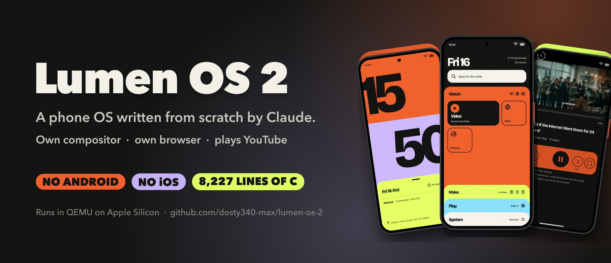
</p>

<p align="center">
  <a href="#run-it"></a>
  
  
  
  <a href="LICENSE"></a>
</p>

<h3 align="center">No Android. No iOS. No UI toolkit. No browser engine.<br>Just a Linux kernel, and everything above it written by Claude.</h3>

<p align="center">
  <a href="#-what-it-can-do">Features</a> ·
  <a href="#-screenshots">Screenshots</a> ·
  <a href="#-how-it-works">How it works</a> ·
  <a href="#run-it">Run it</a> ·
  <a href="#-the-story">The story</a> ·
  <a href="docs/TECHNICAL.md">Technical docs</a>
</p>

---

<table>
<tr>
<td width="50%" align="center">
  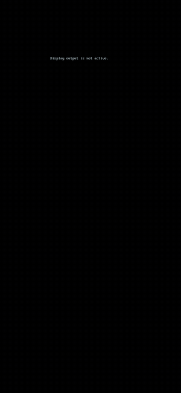<br>
  <sub><b>Boot → lock → push the slab → drawers</b></sub>
</td>
<td width="50%" align="center">
  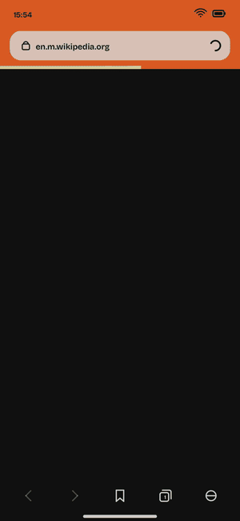<br>
  <sub><b>Its own browser → YouTube → fullscreen rotation</b></sub>
</td>
</tr>
</table>

## ✦ What it can do

| | |
|---|---|
| 🟧 **Slab design** | Solid colour slabs that stack and overlap, giant numerals, accordion drawers instead of an icon grid. No gradients, no glass, no shadows. Designed to look like nothing else. |
| 🔒 **Lock screen** | The hour and the minutes bleed off the edges, live weather from the internet, notifications. Push the lime slab up and the bands follow like stacked paper. |
| 🗂 **Home** | Four drawers (Watch, Make, Play, System). One opens at a time, with springs and fling physics everywhere. |
| 🌐 **Real internet** | Its own DHCP client (built from raw Ethernet frames), DNS resolver, HTTP/1.1 client, inflate, and HTTPS through BearSSL. |
| 🧭 **Its own web browser** | HTML tokenizer and tree builder, CSS cascade, block/inline/table layout, forms, tabs, bookmarks. Wikipedia, Hacker News and CNN Lite render on the phone. |
| ▶️ **YouTube** | Search, play with sound, seek, fullscreen with an animated rotation. Every frame and audio sample is decoded on the phone (30 fps, 0 dropped). |
| 📱 **Apps** | Video, Web, Photos, Notes (own keyboard), Clock (stopwatch, timer), Calculator, 2048, Settings. Everything persists across reboots. |
| 🎛 **System** | Home gesture, control center with real Wi-Fi and airplane toggles, brightness and volume slabs, Now Playing, dark and light themes, accent colour sets. |

## ✦ Screenshots

<p align="center">
  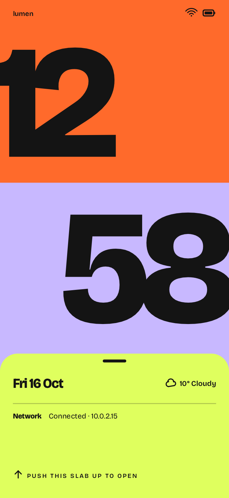
  
  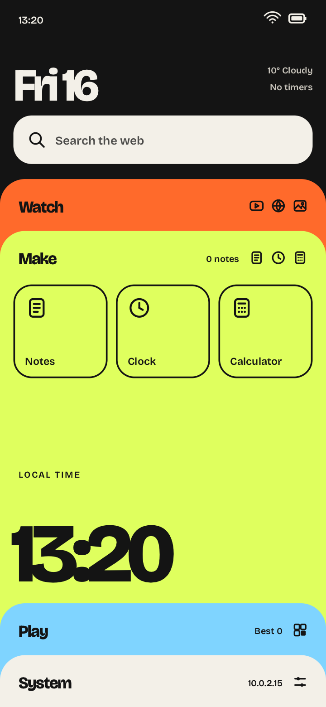
  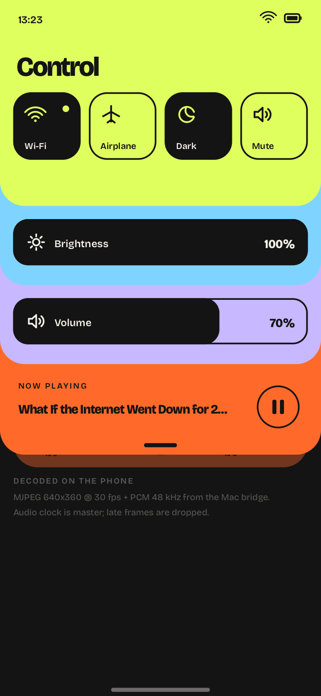
</p>
<p align="center">
  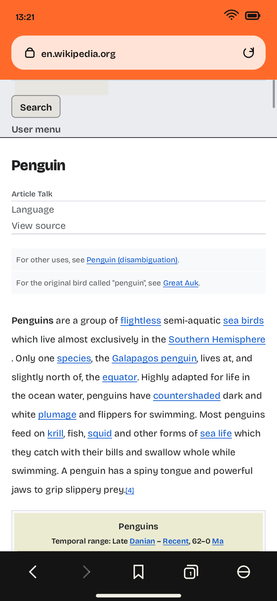
  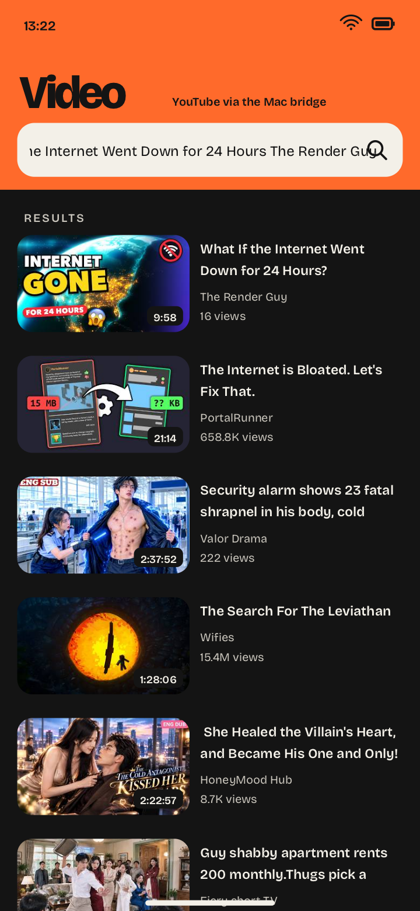
  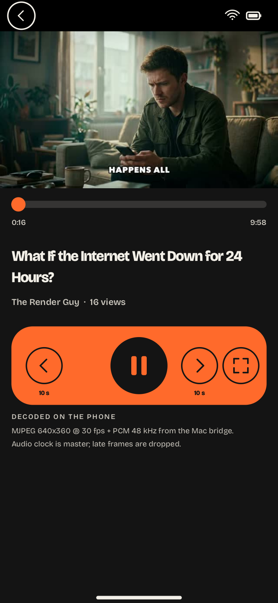
  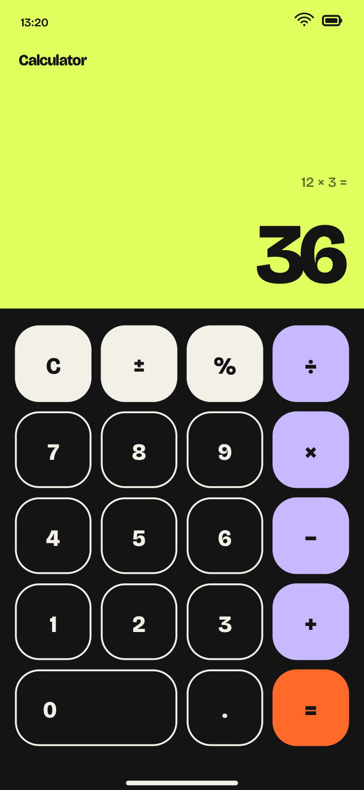
</p>
<p align="center">
  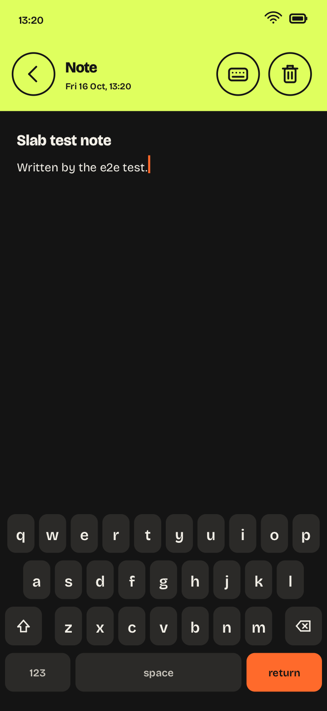
  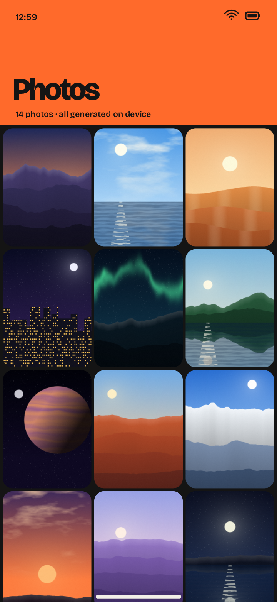
  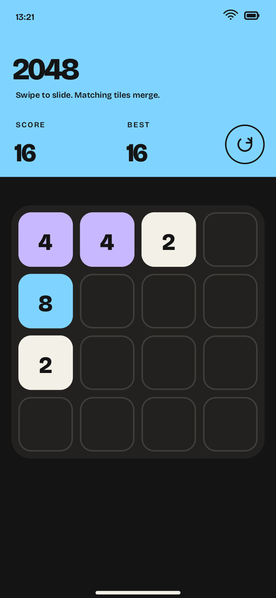
  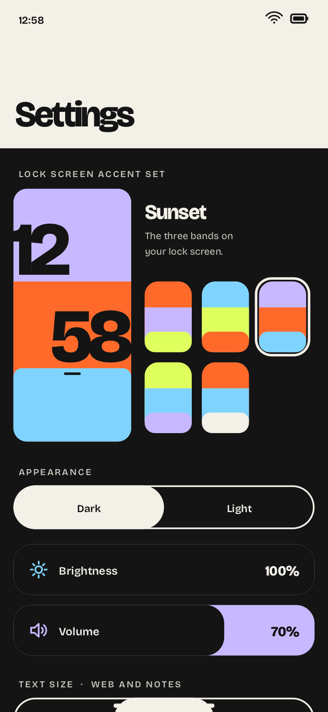
</p>

<p align="center"><sub>Every screenshot was taken by the end-to-end test itself (QMP <code>screendump</code>). More in <a href="screenshots/">screenshots/</a>.</sub></p>

## ✦ How it works

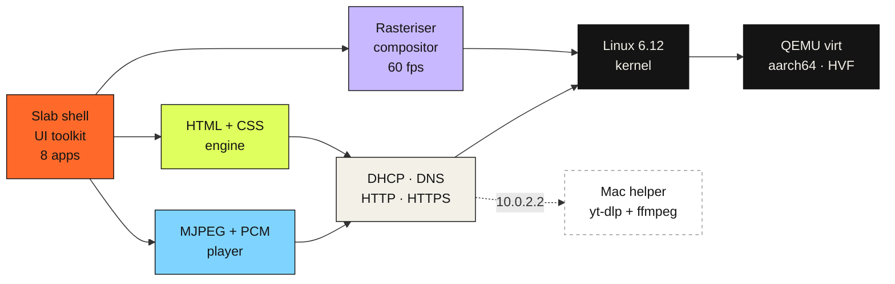

Everything left of the kernel is one C program running as PID 1.

- **Boot:** no bootloader. QEMU loads the kernel and initramfs directly, the framebuffer console is off, so the first pixels you see are drawn by Lumen.
- **Rendering:** a hand-written software rasteriser (signed-distance anti-aliased shapes, glyph cache) feeding double-buffered DRM page flips at a steady 60 fps.
- **Networking:** the kernel only drives the virtual network card and TCP/IP. DHCP, DNS, HTTP, gzip and the browser are Lumen's own code.

### The YouTube bridge, honestly

The phone can't run YouTube's own player, so a small helper runs on the Mac: [`bridge/ytbridge.py`](bridge/ytbridge.py) (Python standard library, about 220 lines). It uses **yt-dlp** to search and resolve streams and **ffmpeg** to re-encode them into a deliberately simple format: baseline JPEG frames plus raw PCM, interleaved as described in [`docs/STREAM.md`](docs/STREAM.md). The phone fetches that over the virtual network with its own HTTP client, then decodes every frame and every audio sample itself and keeps them in sync with the audio clock.

## Run it

You need an Apple Silicon Mac with Docker (colima works) and:

```bash
brew install qemu yt-dlp ffmpeg
```

Then:

```bash
./run.sh
```

Connect a VNC viewer to `localhost:5901`. The mouse is your finger. The first run builds the kernel and userland inside an arm64 container (about 3 minutes), later runs boot in about a second.

<details>
<summary><b>Useful options and tests</b></summary>

| | |
|---|---|
| `LUMEN_DATA=path.img` | use another data disk (notes, settings, history) |
| `LUMEN_AUDIO=wav,id=snd0,path=out.wav` | capture audio to a file instead of playing it |
| `LUMEN_NO_BRIDGE=1` | start without the YouTube bridge |
| `test/e2e.py` | boots the phone headless and drives the whole flow through QMP (32 checks) |
| `test/soak.py` | 5-minute video playback soak test |
| `test/inflate_check.sh` | checks the inflate implementation against zlib |

Serial output (kernel + OS log with frame times and video stats) goes to `build/serial.log`. Touch targets for automation are listed in [`HANDOVER.md`](HANDOVER.md).
</details>

## ✦ By the numbers

| | |
|---|---|
| Own code | **8,227 lines** (about 8,000 lines of C in `src/` + the 220-line bridge) |
| Build time | about **2 hours** of Claude Code, from an empty folder ([`PROGRESS.log`](PROGRESS.log)) |
| Tests | **32 / 32** end-to-end checks passing ([report](screenshots/e2e/REPORT.txt)) |
| UI | **60 fps** median (frame work 4 to 10 ms) |
| Video | **30.0 fps**, 0 dropped frames over a 316 s soak, max A/V lag 28 ms |
| Network up | own DHCP client configures the interface in about **35 ms** |

## ✦ Written from scratch vs. third-party

Everything in `src/` was written for this project. The only third-party code:

| What | Used for |
|---|---|
| Linux 6.12 LTS kernel | drivers and TCP/IP underneath everything |
| musl libc | C library |
| `stb_truetype.h`, `stb_image.h` | glyphs, PNG/JPEG decoding (including every video frame) |
| BearSSL 0.6 | TLS for HTTPS |
| Mozilla CA bundle | certificate validation |
| Bricolage Grotesque (OFL) | the only font |

There is no JavaScript engine: the browser renders HTML and CSS only. Full details in [`docs/TECHNICAL.md`](docs/TECHNICAL.md) and [`ARCHITECTURE.md`](ARCHITECTURE.md).

## ✦ The story

This is **part 2**. In part 1, Claude built a phone OS from scratch and a lot of people watched it. The top comment said it looked like an iOS clone, and honestly it did.

So for part 2, Claude designed three completely new phone UIs (Orbit, Folio and Slab), "Slab" won, and Claude Code built the whole OS again from an empty folder, this time with real internet and YouTube. The original prompt is in [`PROMPT.md`](PROMPT.md).

<p align="center">
  <a href="https://youtu.be/ANYIBMva0wI"></a>
  <a href="https://www.youtube.com/channel/UCRsIdKfLTPW1rCOrOOfBAmA"></a>
</p>

## License

[MIT](LICENSE) for the Lumen OS code. Third-party components keep their own licenses: BearSSL (MIT, `third_party/bearssl/LICENSE.txt`), stb (public domain / MIT), Bricolage Grotesque (SIL OFL, `third_party/fonts/OFL.txt`), Mozilla CA bundle (MPL 2.0), Linux (GPL-2.0, not included in this repository).

<p align="center"><sub>Built by <b>Claude</b> (Anthropic) with Claude Code · made for <b>The Render Guy</b></sub></p>
